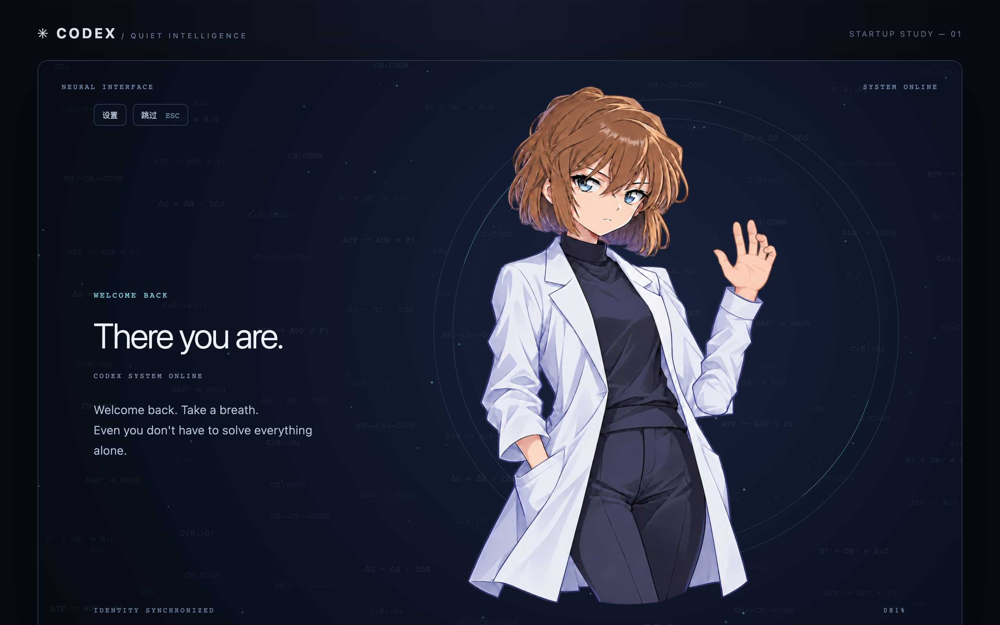

# Codex Quiet Startup · 静态人物版

为 macOS Codex 桌面应用制作的独立启动动画：**粒子聚合 → 人物轮廓描线 → 角色登场 → 切入 Codex**。

**公开版只提供固定姿势的静态人物**，手部、身体和表情保持不动；粒子聚合、轮廓描线、化学式流动背景仍会播放。人物动作不属于本版本的功能。

采用 HTML / CSS / Canvas 和原生 Swift + WKWebView。默认 9 秒、全屏播放，可跳过，可替换人物和背景。角色为短茶色头发、白大褂的二次元研究员形象。

这是个人创作项目，与 OpenAI 无隶属关系。独立启动器不会修改官方应用安装包。



> 图为浏览器预览；通过安装后的启动器启动时，画面铺满当前显示器。

## 快速安装（macOS）

需要：

- macOS 13 或更高版本；实测为 Apple Silicon / macOS 26.5.1。
- 已安装官方 Codex 桌面应用，其应用标识为 `com.openai.codex`。不同版本的显示名称可能不同。
- Xcode Command Line Tools，提供 Git、Swift 编译器和 macOS SDK。

如果尚未安装编译工具，先运行下面的命令，并等待系统安装完成：

```bash
xcode-select --install
```

然后克隆、编译和安装：

```bash
git clone https://github.com/wangyutao-0602/codex-quiet-startup-public.git
cd codex-quiet-startup-public
bash tools/install-macos.sh
open "$HOME/Applications/Codex Quiet Startup.app"
```

安装位置是 `~/Applications/Codex Quiet Startup.app`，可将它拖入 Dock。以后从**这个启动器**打开 Codex，即可看到动画；直接点击官方应用图标不会播放动画。

构建和日常运行不需要 Node.js、npm、API Key 或远程素材服务。安装器使用本机 ad-hoc 签名，不是 Apple 公证发行包。重复安装时会保留带时间戳的旧版本备份。

## 预览与设置

### 原生预览

安装后运行：

```bash
open "$HOME/Applications/Codex Quiet Startup.app" --args --preview
```

打开设置：

```bash
open "$HOME/Applications/Codex Quiet Startup.app" --args --settings
```

运行不同模式前，先退出仍在运行的启动器，以免 macOS 将请求交给现有实例而忽略新参数。

### 浏览器预览

安装 Python 3 后，在仓库根目录执行：

```bash
bash tools/preview.sh
```

打开 [http://127.0.0.1:8765](http://127.0.0.1:8765)。按 `Ctrl+C` 关闭服务器。浏览器模式提供暂停、重播和时间轴；不会启动官方应用。若端口已占用，可使用 `python3 -m http.server 8766 --bind 127.0.0.1`，再访问相应端口。

## 动画与自定义

| 默认时间 | 内容 |
| --- | --- |
| 0–1.2 秒 | 系统唤醒、中央光点与 HUD 圆环 |
| 1.2–3 秒 | 粒子从屏幕边缘聚合到人物轮廓 |
| 3–5.5 秒 | 沿图像边缘描线，角色逐渐显现 |
| 5.5–7.5 秒 | 完整角色与英文欢迎词 |
| 7.5–9 秒 | 原生启动保持画面，结束后撤下窗口并交给 Codex |

浏览器预览的最后一段仍采用淡出。时间段随总时长等比例缩放。

设置面板支持：

- 人物图、背景图：PNG / JPEG / WebP，最大 20 MB；人物推荐透明 PNG。
- 初始化、欢迎与系统在线文字。
- 5–15 秒时长、80–600 粒子、发光强度和 30/60 FPS。
- 完整、减少、自动三种动态效果模式。

默认使用**完整动态效果**，保留粒子聚合和描线。选择“自动”会跟随系统的减少动态效果偏好，选择“减少”会简化为淡入淡出；所有模式的人物姿势都固定不动。Esc 或“跳过”按钮可结束动画。

设置保存在宿主的本地 IndexedDB 中；浏览器和原生应用的设置互相独立。恢复默认后，需点击“保存并预览”。图片读取失败会退回星环动画。

若已有旧设置，希望明确启用并保存完整动态效果：

```bash
open "$HOME/Applications/Codex Quiet Startup.app" --args --full-motion
```

主标题与补充英文台词在 `animation.js` 和 `index.html` 中修改；这些补充台词不属于设置面板的三个文字字段。修改源码后重新运行安装脚本。

## 窗口交接的实际行为

启动器使用覆盖当前显示器的无边框窗口，并在后台打开或复用 Codex。结束时先撤下启动窗口，再通过 LaunchServices 打开官方应用，确认其进程未隐藏、已激活后退出。失败会显示错误提示。

启动器**不会强制官方 Codex 进入全屏**。如果希望切入全屏 Codex，请事先在官方应用内手动设置。多显示器和跨 Spaces 切换由 macOS 管理，不保证逐帧同步；进程激活也不等于聊天页面完成加载。

## 常见问题

**只看到淡入，没有粒子聚合？** 进入设置，将动态效果改为“完整”并保存。

**找不到 Codex？** 确认官方桌面应用已经安装且可以独立打开。启动器按 `com.openai.codex` 查找，不只依赖应用名称；其他应用标识不受当前版本支持。

**动画结束后没有进入 Codex？** 查看启动器的错误提示，先从官方应用图标确认它能正常打开。需要诊断日志时运行：

```bash
"$HOME/Applications/Codex Quiet Startup.app/Contents/MacOS/AemeathStartup" --launch
```

**修改源码后没有生效？** 退出旧启动器，再运行 `bash tools/install-macos.sh`。仅双击旧 `.app` 不会重新编译源码。

## 更新、卸载与恢复

本公开仓库于 2026-10-23 将主分支历史整理为静态版快照。此前克隆的副本请先备份本地修改，再克隆到新目录；不要直接合并旧历史。新克隆的副本可按下列方式更新：

```bash
git pull --ff-only
bash tools/install-macos.sh
```

卸载：退出启动器，把 `~/Applications/Codex Quiet Startup.app` 移至废纸篓，并按需移除 Dock 图标及旧版本备份。直接打开官方 Codex 即可恢复原来的启动方式，无需重装官方应用。卸载应用不自动清除 WKWebView 的本地设置。

## 开发与验证

Node.js 22+ 仅用于开发测试：

```bash
npm ci
npm test
npm run test:render
```

浏览器检查需要单独保持预览服务器运行：

```bash
npx playwright install chromium
npm run test:browser
```

也可指定已有 Chromium 系浏览器，例如：

```bash
CHROMIUM_PATH='/Applications/Microsoft Edge.app/Contents/MacOS/Microsoft Edge' npm run test:browser
```

原生构建和烟测：

```bash
bash tools/build-macos.sh
codesign --verify --deep --strict 'dist/Aemeath Startup.app'
'dist/Aemeath Startup.app/Contents/MacOS/AemeathStartup' --smoke-test --full-motion
```

`dist/Aemeath Startup.app` 沿用上游构建名称；安装脚本会将它安装为 `Codex Quiet Startup.app`。烟测失败返回非零退出码。

已执行的验证包括 6 项核心测试、14 项浏览器检查、五阶段离屏渲染、arm64 原生构建/签名、WKWebView 500 条轮廓提取和运行中官方应用的激活交接。冷启动、Intel 实机、多显示器、官方聊天交互与长期能耗没有完整验证。详见 [测试说明](docs/MAC-ACCEPTANCE.md)。

## 目录

```text
Native/                 Swift 启动器与保留的扩展入口
assets/character.png    默认角色素材
index.html / style.css  页面与样式
animation.js            时间轴、粒子、描线和宿主通信
image-settings.js       配置、图片导入和轮廓提取
tools/                  构建、安装、预览工具
tests/                  核心、渲染与浏览器测试
docs/                   来源、素材和验证说明
extension/              上游扩展实验路径
```

上游的扩展注入路径为实验功能，普通用户使用上述独立启动器即可。本项目没有在真实官方应用中完成扩展路径兼容性验收；具体说明见 [上游说明](docs/UPSTREAM-README.md)。

## 来源与素材权利

基于 [panding999/codex-startup-animation](https://github.com/panding999/codex-startup-animation)，所用基准提交为 `c743c2b5eceaa7be9dc511d23a1a77f7c4ce6248`。原生主体与上游来源说明保留，动画层及交接逻辑经过改造。

人物素材由图像生成工具制作，提示词见 [ART-PROMPT.md](docs/ART-PROMPT.md)。角色、商标和历史素材涉及的权利归各自权利人。本仓库未额外授予第三方素材许可，也未新增覆盖上游代码的许可证；公开源码不等于授予所有素材的自由使用或商业授权。

## 单独检查人物

运行 `bash tools/preview.sh` 后，打开 [静态立绘预览](http://127.0.0.1:8765/docs/motion-preview.html)。人物为固定抬手姿势：食指和中指伸展，无名指与小指弯曲，手腕位置固定。

背景包含 126 项流动化学式，默认以 60 FPS 为调度目标；减少动态效果模式停用漂移。设置面板可更换人物图、背景、文字和时长。
